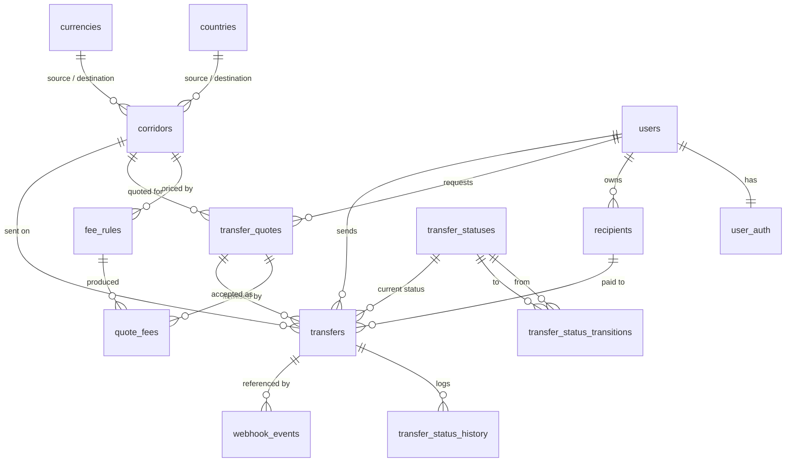

# AaminPay database schema (v1)

> **Updated 2026-10-04 — migration 0022 (hardening).** New `rate_limit_hits` (UNLOGGED: `key`, `hits`, `reset_at`; shared
> rate-limit counters), `system_settings` (`key`, `value` JSONB, `updated_by`, `updated_at`; first key
> `transfers_paused`) and `two_factor_recovery_codes` (`user_id`, `code_hash`, `used_at`; hashes only). Nothing was
> dropped; rolling back drops only these three tables.

> **Updated 2026-10-03 — migration 0021 (admin roles).** New `user_roles` (`user_id`, `role` in
> `admin`/`support`, `granted_at`, `granted_by`). Every user is a customer; a row adds a staff role. Nothing was
> dropped; rolling back drops only this table.

> **Updated 2026-10-03 — migration 0019 (send-money flow).** `transfers` gained
> `recipient_reference` (the customer's own reference for the recipient, 1–35
> characters, optional). Nothing was dropped.

> **Updated 2026-10-03 — migration 0018 (onboarding).**
>
> - `provider_links.provider_customer_id` is now nullable: the row is created
>   `PENDING` when onboarding starts, before the provider has given an id. A
>   check constraint forbids `VERIFIED` without one.
> - `provider_links.kyc_status` gained `REJECTED_PENDING_REVIEW` (the provider
>   verified someone whose name or date of birth does not match our profile).
> - New `onboarding_states` (`user_id`, `provider`, `state_hash` unique,
>   `expires_at`, `used_at`): the single-use CSRF state for the provider's
>   redirect. Only the SHA-256 of the state is stored.
> - `user_auth` gained `totp_secret_encrypted`, `totp_key_version`,
>   `totp_enabled_at`, `totp_last_counter` (optional two-step sign-in).
> - Nothing was dropped. Rolling 0018 back deletes links that have no provider
>   customer id and turns `REJECTED_PENDING_REVIEW` into `REJECTED`.

> **Updated 2026-10-03 — migrations 0012 to 0014.** The descriptions below
> predate the provider-neutral layer. What changed:
>
> - `users` gained `provider_verification_status`, `provider_verification_updated_at`,
>   `payout_provider` and `provider_customer_ref` (the customer's link to their
>   own provider account; written only from provider data).
> - Transfer statuses are now `DRAFT`, `AWAITING_FUNDS`, `PROCESSING`, `SENT`,
>   `COMPLETED`, `CANCELLED`, `REFUNDED`, `FAILED`.
>   `transfer_status_transitions` has a `requires_provider_evidence` flag that
>   the status trigger enforces. See [`../STATUSES.md`](../STATUSES.md).
> - `transfers` gained `answers` (JSONB) and `sent_at`; `corridor_id` is nullable;
>   `provider` accepts `mock`, `wise`, `airwallex`, `currencycloud`.
> - `transfer_quotes`: `wise_quote_id` became `provider_quote_id`; added
>   `provider` and `estimated_delivery`; `corridor_id` is nullable.
> - `recipients` now hold a **summary only**: `account_summary`, `provider`,
>   `provider_recipient_id`. The bank-detail columns (`bank_name`,
>   `bank_account_number`, `bank_code`, `iban`, `mobile_wallet_provider`,
>   `mobile_number`, `payout_method`) were dropped.
> - `currencies` is now also a cache of the active provider's currency list.
>   `countries`, `corridors` and `fee_rules` are no longer used by the
>   send-money flow.
> - `webhook_events.provider` accepts all four providers; the dedupe key is the
>   SHA-256 of the signed body.
>
> **Updated 2026-10-03 — migrations 0015 to 0017 (data model).**
>
> | Model           | Table here        | Notes                                                                                                                                                                                                                                                                 |
> | --------------- | ----------------- | --------------------------------------------------------------------------------------------------------------------------------------------------------------------------------------------------------------------------------------------------------------------- |
> | users           | `users`           | Added `phone`, `first_name`, `last_name`, `date_of_birth`, `country_of_residence` (all optional). `status` keeps its existing lower-case values (`active`, `suspended`, `closed`).                                                                                    |
> | provider_links  | `provider_links`  | New. One row per (user, provider): `provider_customer_id`, `provider_profile_id`, `kyc_status`, `encrypted_refresh_token`, `token_key_version`, `linked_at`, `updated_at`.                                                                                            |
> | recipients      | `recipients`      | Unchanged since 0014. `country_code` / `currency_code`; also keeps `account_holder_name`.                                                                                                                                                                             |
> | quotes          | `transfer_quotes` | `destination_currency` = target currency, `destination_amount_minor` = target amount, `fee_amount_minor` = fee, `exchange_rate` (NUMERIC 24,12) = rate. `source_amount_minor` is the amount converted; `total_to_pay_minor` = source + fee is what the customer pays. |
> | transfers       | `transfers`       | Added `funding_method`. New rows need a UUID `idempotency_key`, unique across users. Also keeps a snapshot of the quote amounts.                                                                                                                                      |
> | transfer_events | `transfer_events` | The former `transfer_status_history`, renamed in place: `status`, `source`, `occurred_at`, `raw_payload`, plus `from_status`, `reason`.                                                                                                                               |
> | webhook_events  | `webhook_events`  | `provider_event_id` is now always set and unique per provider. `event_type` = type, `signature_verified` = signature_valid, `processing_error` = error.                                                                                                               |
> | audit_log       | `audit_events`    | Unchanged: `entity_type` / `entity_id` = target, `ip_address` = ip.                                                                                                                                                                                                   |
>
> **Deprecated, kept because they hold data** (marked with a database comment):
> `users.payout_provider`, `users.provider_customer_ref`,
> `users.provider_verification_status`, `users.provider_verification_updated_at`
> (replaced by `provider_links`); `transfers.corridor_id`,
> `transfer_quotes.corridor_id`, `transfer_quotes.rate_source`; tables
> `corridors`, `countries`, `fee_rules`. Also no longer read by the app:
> `webhook_events.dedupe_key` is still written (the body hash) but lookups use
> `provider_event_id`.

PostgreSQL 14+. This document describes the schema created by
`backend/migrations/`. It covers only the data required for the first version
(UK → Kenya, GBP → KES). It is the human-readable companion to the migrations,
which are the source of truth.

## Conventions

| Topic            | Rule                                                                                                                                                                 |
| ---------------- | -------------------------------------------------------------------------------------------------------------------------------------------------------------------- |
| Primary keys     | `UUID DEFAULT gen_random_uuid()` (v4, non-sequential) unless the natural key is a short stable code (`countries.code`, `currencies.code`, `transfer_statuses.code`). |
| Money amounts    | `BIGINT`, integer **minor units** of the stated currency (`currencies.minor_unit` gives the exponent). Never `real`/`double precision`.                              |
| Exchange rates   | `NUMERIC(24,12)` — exact decimal. Destination units per 1 source unit.                                                                                               |
| Timestamps       | `TIMESTAMPTZ`. `created_at` everywhere; `updated_at` (maintained by the `set_updated_at()` trigger) on mutable tables. Append-only tables have only `created_at`.    |
| Enum-like fields | `TEXT` + `CHECK (... IN (...))`, or a small reference table where transitions matter.                                                                                |
| Deletion         | Financial rows are never hard-deleted by the app. FKs into them use `ON DELETE RESTRICT`.                                                                            |

The `pg` driver returns `BIGINT` and `NUMERIC` as **strings**; application code
converts explicitly (`BigInt(...)` / a decimal library) and never via `number`.

## Entity overview



`audit_events` is intentionally standalone (polymorphic `entity_type` /
`entity_id`, no FK).

## Reference data

### `countries`

ISO 3166-1 alpha-2. `is_send_enabled` / `is_receive_enabled` gate where money can
come from and go to. Seeded: `GB` (send), `KE` (receive).

### `currencies`

ISO 4217 alpha-3. `minor_unit` is the decimal exponent (2 for GBP/KES).
`CHECK (minor_unit BETWEEN 0 AND 4)`. Seeded: `GBP`, `KES`.

### `corridors`

The explicit whitelist of supported routes: `(source_country,
destination_country, source_currency, destination_currency)`, unique, with
`source_country <> destination_country`. Quotes and transfers reference a
corridor, so only approved combinations can be transacted. Seeded: `GB/GBP →
KE/KES`.

## Users

### `users`

`id`, `email` (`CITEXT`, unique, format-checked), `status`
(`active|suspended|closed`), `email_verified_at`, timestamps.
Deliberately minimal — legal name, date of birth, address and identity documents
belong to the later KYC milestone with their own handling.

### `user_auth` (1:1 with `users`, `PK = user_id`, `ON DELETE CASCADE`)

`password_hash` (Argon2id hash only — never plaintext, never logged),
`password_algorithm` (`CHECK IN ('argon2id')`), `password_updated_at`,
`failed_login_attempts` (`>= 0`), `locked_until`, `last_login_at`,
`last_login_ip`. MFA/TOTP secrets are not stored yet; when added they will be
application-layer encrypted. Populated by registration; the lockout columns are
maintained atomically by login (migration `0009`).

## Authentication (migration `0009`)

### `auth_sessions`

One row per refresh-token session. `refresh_token_hash` (`UNIQUE`) is the
SHA-256 of a 256-bit opaque token — the raw token is returned to the client
once and never stored. `family_id` groups a session and all its rotations;
`previous_session_id` chains them. `roles` (`TEXT[]`) is carried across
rotations. `status` is `active | rotated | revoked`
(`(status='revoked') = (revoked_at IS NOT NULL)`), `expires_at` is the absolute
refresh expiry. Indexes: partial `(user_id) WHERE status='active'`,
`(family_id)`. `ON DELETE CASCADE` from `users`.

Rotation: `/auth/refresh` marks the presented session `rotated` and inserts a
new `active` one in the same family. Presenting a non-`active` refresh token
revokes the whole family (reuse detection).

### `auth_tokens`

Single-use, time-limited tokens for `email_verification` and `password_reset`
(`purpose` CHECK). `token_hash` (`UNIQUE`) is the SHA-256 of the raw token;
`consumed_at` marks it used. Consuming is one atomic `UPDATE ... WHERE
consumed_at IS NULL AND expires_at > now() RETURNING user_id`. Partial index
`(user_id, purpose) WHERE consumed_at IS NULL`.

## Recipients

### `recipients`

Belongs to a `user` (`ON DELETE RESTRICT`). `payout_method` is
`bank_account | mobile_money`; method-specific columns are required by CHECK
constraints:

| method         | required columns                                                 |
| -------------- | ---------------------------------------------------------------- |
| `bank_account` | `bank_name`, `bank_account_number` (+ optional `bank_code`)      |
| `mobile_money` | `mobile_wallet_provider`, `mobile_number` (E.164, regex-checked) |

`is_active` / `archived_at` are kept consistent by a CHECK. **No card numbers or
CVV** are stored — ever. Account and mobile identifiers are payout-essential;
at-rest protection is cluster-level encryption, with application-layer field
encryption tracked as a follow-up.
Indexes: `(user_id)`, partial `(user_id) WHERE is_active`.

Migration `0010` adds `iban` (alternative to account number + sort code) and the
Wise linkage `wise_recipient_id` (unique) / `wise_recipient_type`, populated when
the recipient is first used in a transfer.

## Fees

### `fee_rules`

Time-bounded fee configuration per corridor. `fee_type` is `fixed | percentage`:

- `fixed`: `fixed_amount_minor` (`>= 0`) in `fixed_amount_currency`
- `percentage`: `percentage_basis_points` (integer, `0..100000`; 1 bp = 0.01%)

`effective_from` / `effective_to` (`effective_to > effective_from` or NULL).
Partial unique index `fee_rules_one_open_ended (corridor_id, fee_type) WHERE
effective_to IS NULL` — at most one currently-active rule per corridor and type.
Seeded: flat **GBP 1.99** transfer fee for `GB → KE` (example configuration, to
be tuned by the business).

The fee actually charged to a customer is recorded per quote in `quote_fees`, so
historic quotes remain fully reconstructable even if `fee_rules` change.

## Quotes

### `transfer_quotes` — immutable

A backend-calculated, time-limited offer. `UPDATE` is rejected by the
`prevent_update()` trigger.

| column                     | notes                                                   |
| -------------------------- | ------------------------------------------------------- |
| `source_amount_minor`      | transfer principal, before fee (`> 0`)                  |
| `fee_amount_minor`         | total fee in source currency (`>= 0`)                   |
| `total_to_pay_minor`       | **generated**: `source_amount_minor + fee_amount_minor` |
| `destination_amount_minor` | amount the recipient receives (`> 0`)                   |
| `exchange_rate`            | `NUMERIC(24,12)`, `> 0`                                 |
| `rate_source`              | `internal                                               | wise` |
| `wise_quote_id`            | the Wise quote this offer is bound to (added in `0010`) |
| `expires_at`               | `> created_at`                                          |

A `BEFORE INSERT` trigger rejects a quote whose `source_currency` /
`destination_currency` do not match its `corridor_id`.
Indexes: `(user_id, created_at DESC)`, `(expires_at)`.

### `quote_fees` — immutable

Line items for a quote (`ON DELETE CASCADE` from the quote). Each references the
`fee_rule_id` that produced it (nullable, `ON DELETE RESTRICT`), with a
`description`, `amount_minor` (`>= 0`) and `currency_code`. The backend
guarantees the line items sum to the quote's `fee_amount_minor`.

## Transfers

### `transfer_statuses` (reference)

`code` PK, `description`, `is_terminal`, `sort_order`. Reworked in migration
`0010` to match the states the Wise integration actually produces.

| code               | terminal | meaning                                                                                     |
| ------------------ | :------: | ------------------------------------------------------------------------------------------- |
| `created`          |    no    | created from an accepted quote                                                              |
| `awaiting_payment` |    no    | Wise transfer created; awaiting funding from the AaminPay balance                            |
| `processing`       |    no    | funded; Wise is paying out to the recipient                                                 |
| `completed`        |    no    | Wise confirmed `outgoing_payment_sent` (a later chargeback can still move it to `refunded`) |
| `failed`           |    no    | will not complete (a later `refunded` is still possible)                                    |
| `cancelled`        | **yes**  | cancelled before completion                                                                 |
| `refunded`         | **yes**  | funds returned (bounce-back, chargeback or refund)                                          |

Only `cancelled` and `refunded` are truly terminal — `completed` / `failed` stay
open to a `refunded` follow-up.

### `transfer_status_transitions` (reference)

The allowed edges of the state machine, `PRIMARY KEY (from_status, to_status)`,
`from_status <> to_status`:

```
created          → awaiting_payment, failed, cancelled
awaiting_payment → processing, failed, cancelled
processing       → completed, failed, refunded
completed        → failed, refunded
failed           → refunded
(cancelled / refunded: no outgoing transitions)
```

### `transfers`

The financial figures are a **frozen snapshot** copied from the accepted quote.

Key columns: `reference` (unique, human-facing), `user_id`, `recipient_id`,
`quote_id`, `corridor_id` (all `ON DELETE RESTRICT`), `status`
(FK → `transfer_statuses`, default `created`), `idempotency_key`,
`source_currency` / `destination_currency`, `source_amount_minor`,
`fee_amount_minor`, `total_to_pay_minor`, `destination_amount_minor`,
`exchange_rate`, provider linkage (`provider`, `provider_transfer_id`,
`provider_status` — populated once the transfer is submitted to Wise), and
lifecycle timestamps (`submitted_to_provider_at`, `completed_at`, `failed_at`,
`cancelled_at`, `refunded_at` (added in `0010`), `failure_reason`).

Constraints:

- `UNIQUE (reference)`
- `UNIQUE (user_id, idempotency_key)` — idempotent creation
- `UNIQUE (provider, provider_transfer_id)` — one provider transfer ↔ one AaminPay transfer
- amounts `> 0`; `fee_amount_minor >= 0`; `total_to_pay_minor = source + fee`; `exchange_rate > 0`
- `provider_transfer_id` set ⇒ `provider` set; `provider IN ('wise')`
- `completed` / `failed` / `cancelled` / `refunded` ⇒ the matching `*_at` timestamp is set

Triggers:

| trigger                               | timing              | effect                                                                                                                                                                                   |
| ------------------------------------- | ------------------- | ---------------------------------------------------------------------------------------------------------------------------------------------------------------------------------------- |
| `transfers_match_corridor`            | BEFORE INSERT       | rejects currencies that do not match `corridor_id`                                                                                                                                       |
| `transfers_set_updated_at`            | BEFORE UPDATE       | maintains `updated_at`                                                                                                                                                                   |
| `transfers_freeze_financials`         | BEFORE UPDATE       | rejects changes to reference, links, idempotency key, currencies, amounts, rate, `created_at`                                                                                            |
| `transfers_enforce_status_transition` | BEFORE UPDATE       | rejects transitions not in `transfer_status_transitions`; rejects any change out of a terminal status                                                                                    |
| `transfers_record_status_history`     | AFTER INSERT/UPDATE | writes `transfer_status_history` (initial `NULL → created`, then every change); `actor_type` is `provider_webhook` when `provider_status` also changed, else `system` (migration `0010`) |

Indexes: `(user_id, created_at DESC)`, `(recipient_id)`, `(quote_id)`,
`(status)`, partial `(provider, provider_transfer_id) WHERE provider_transfer_id
IS NOT NULL`.

### `transfer_status_history` — append-only

`transfer_id` (FK, no cascade), `from_status` (NULL for the initial row),
`to_status`, `reason`, `actor_type` (`system|customer|admin|provider_webhook`),
`actor_id`, `metadata` JSONB. `UPDATE`/`DELETE` rejected by
`prevent_update_delete()`. Index `(transfer_id, created_at)`.

## Provider webhooks

### `webhook_events`

`provider` (`CHECK IN ('wise')`), `dedupe_key`, `provider_event_id`,
`event_type`, `signature_verified` (**NOT NULL** — the ingestion path must record
the verification result), `payload` JSONB, `related_transfer_id`
(`ON DELETE SET NULL`), `processing_status`
(`pending|processed|ignored|failed`), `processing_error`, `received_at`,
`processed_at`.

Constraints:

- `UNIQUE (provider, dedupe_key)` — idempotent ingestion of redelivered events
- `processing_status = 'processed'` ⇒ `signature_verified` is true
- `processed_at` is set iff `processing_status` is a terminal processing state

Indexes: partial `(processing_status) WHERE = 'pending'`, partial
`(related_transfer_id)`.

## Audit

### `audit_events` — append-only

`actor_type` (`user|system|admin|provider`), `actor_id` (NULL for `system`),
`action` (e.g. `transfer.created`), `entity_type` + `entity_id` (polymorphic, no
FK), `context` JSONB (**non-sensitive only** — no secrets, tokens, card data or
identity documents), `request_id`, `ip_address`. `UPDATE`/`DELETE` rejected.
Indexes on `(entity_type, entity_id, created_at DESC)`, `(actor_type, actor_id,
created_at DESC)`, `(action, created_at DESC)`.

## Shared database objects (migration `0001`)

| object                           | purpose                                                                              |
| -------------------------------- | ------------------------------------------------------------------------------------ |
| extension `citext`               | case-insensitive email storage                                                       |
| `set_updated_at()`               | trigger fn: set `updated_at = now()` on UPDATE                                       |
| `prevent_update()`               | trigger fn: reject UPDATE (immutable rows)                                           |
| `prevent_update_delete()`        | trigger fn: reject UPDATE and DELETE (append-only rows)                              |
| `enforce_row_matches_corridor()` | trigger fn (migration `0002`): a quote/transfer's currencies must match its corridor |

## Not in v1 (deferred to later milestones)

KYC / identity data, MFA secrets, sessions & refresh tokens, payment-instrument
records for collecting the customer's inbound funds, ledger / double-entry
accounting, refunds & reversals, multi-corridor rate tables, notification
records. Each arrives with its own migration and review.
